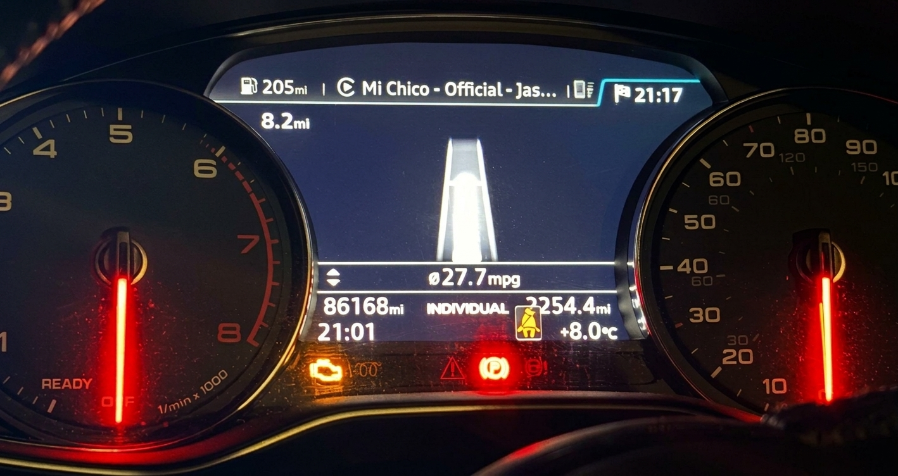
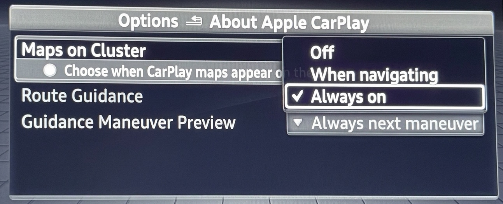

# MHI2Q CarPlay Enhanced

CarPlay maps, guidance and telephone controls for Audi MHI2Q units with a
map-over-MOST instrument cluster. Based on
[Luka's mib2q-carplay-rgi](https://github.com/luka-dev/mib2q-carplay-rgi).
Thanks to Luka and the upstream contributors for the foundation.

## Compatibility

The prepared package targets **MU1329 / `MHI2Q_ER_AUG22_P5092`**, tested on one
Audi with analogue dials and a colour MOST display (coding 541=1).
Virtual Cockpit (541=2) is unvalidated; its map firewall change is not
included. Do not install this firmware-specific package on another firmware.

Use at your own risk: this modifies firmware files and configuration. The managed
installer checks identities and keeps backups. Remove other CarPlay cluster or
AltScreen mods with their own uninstallers first. Roll back before updating firmware.

## What you get

- The phone's CarPlay map in the MOST MAP view, with steering-wheel roller zoom
  and the cluster's Light / Dark / Automatic theme. Waze ignores zoom and theme.
- CarPlay maneuvers, lane arrows, distance and guidance text on the supported
  cluster/HUD paths; cover art on the cluster.
- Calls, recents, favourites and phone battery on the cluster telephone tab.
  Directory contacts continue through Audi's stock address-book service.
- Vehicle range, outside temperature and wheel speed sent to the phone.
- Short-press Siri, the CarPlay telephone popup skipped, MMI touchpad D-pad input,
  and parking popups that keep CarPlay visible.
- USB re-arm/NCM recovery, reduced video-decoder queues and reduced media-scanning work.

Spatial audio, 5.1, UpMix and wireless CarPlay are disabled.
See [feature support](docs/FEATURES.md) for capabilities and limitations.

## Maps on Cluster

Choose **Off / When navigating / Always on** in the MMI:

- **Off:** use Audi's map.
- **When navigating:** show the CarPlay map while the phone owns navigation.
- **Always on:** show the CarPlay map whenever a live map stream is available.

The default is Always on. Guidance arrows work independently. VC-specific map-card
options and disabled audio options are hidden on MOST.

## Download

Get the firmware-matched SD package from
[Releases](https://github.com/waterfalldev/mib2q-carplay-enhanced-nonfpk/releases).
GitHub's generated source archives are not SD installers.

## Install on the car

1. Extract the firmware-matched SD ZIP to the M.I.B. SD-card root, so it contains `mod/`.
2. Disconnect CarPlay. Run **M.I.B. → Advanced Settings → Run Custom Script**
   (older versions: **Run individual script**).
3. Wait for result `0`, wait a few more seconds, then restart the head unit manually
   with CarPlay disconnected.

The next run of the same entry captures logs and rolls back. Keep that card and its
backups until removal is complete. The installer does not reboot the unit itself.

[Install, rollback and recovery](docs/build-and-deploy/DEPLOY_AND_RELEASE.md)
explain the on-unit files and failure handling.

## Build from source

Follow the [build guide](docs/build-and-deploy/BUILD_SYSTEM.md).
Verified stock firmware inputs are required.

## Documentation

See the [documentation guide](docs/README.md) for settings, building and runtime details.
