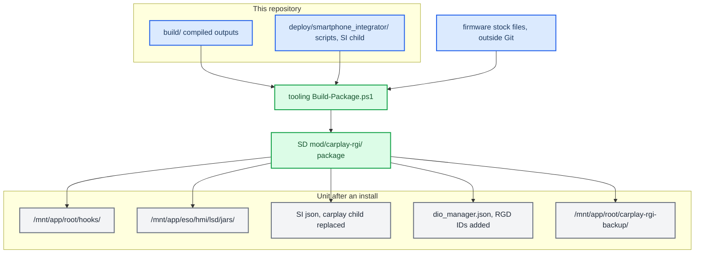

# Deploy and Release

*The build scripts only produce loose binaries. In this fork the [tooling repository](https://github.com/waterfalldev/mib2q-carplay-enhanced-tooling) builds, checks, installs and rolls back packages; this note maps what a package puts on the unit, what upstream's installer did beyond it, and the hand-deploy traps. Never reboot the car without asking.*

---

## 📦 Builds emit binaries, not releases

Each build script writes its outputs into `build/`. The tooling's package builder exports a committed revision of this repository, runs `scripts/java/docker.sh`, `scripts/build_hook.sh` and `scripts/build_renderers.sh` against one firmware's stock files, runs the checks (`scripts/run_tests.sh`, the Java suites, the MOST native tests, its own installer and recovery fixtures) and stages the outputs with the runtime scripts from `deploy/smartphone_integrator/` into an SD overlay. Its README and [installation and recovery](https://github.com/waterfalldev/mib2q-carplay-enhanced-tooling/blob/main/docs/install-and-recovery.md) are the authority for that process.

This fork does not carry upstream's `scripts/prepare_install.sh` or its M.I.B. bundles (`install_MoreIncredibleBash/`, `uninstall_MoreIncredibleBash/`, `logging_MoreIncredibleBash/`). Notes elsewhere in `docs/` that cite them describe [upstream's installer](https://github.com/luka-dev/mib2q-carplay-rgi).



## 🔗 The artifact map

What a package installs (the tooling's `packaging/Payloads.ps1`):

| File | Source in the repo | On-unit path | Mode |
|---|---|---|---|
| `libcarplay_hook.so` | `build/unprotected/` (`build_hook.sh`) | `/mnt/app/root/hooks/` | 644 |
| `maneuver_render` | `build/` (`build_renderers.sh`) | `/mnt/app/root/hooks/` | 755 |
| `altscreen_render` | `build/` (`build_renderers.sh`) | `/mnt/app/root/hooks/` | 755 |
| `flag_atlas.rgba` | `maneuver_render/resources/` | `/mnt/app/root/hooks/` (`maneuver_render/main.c:45`) | 644 |
| `carplay_{startup,monitor,processes,cleanup}.sh` | `deploy/smartphone_integrator/` | `/mnt/app/root/hooks/` | 755 |
| `carplay_hook.jar` | `build/`, compiled and link-checked against the package's firmware `lsd.jar` | `/mnt/app/eso/hmi/lsd/jars/` | 644 |
| `smartphone_integrator.json` | built from the verified stock file with `children.carplay` replaced by `deploy/smartphone_integrator/carplay_child.json` | `/mnt/system/etc/eso/production/` | kept from the live file |
| `dio_manager.json` | built from the verified stock file with the five route-guidance IDs added ([below](#-route-guidance-message-ids-in-dio_managerjson)) | `/mnt/system/etc/eso/production/` | kept from the live file |
| `carplay_rgi_install.state` | written by the installer, last | `/mnt/app/root/hooks/` | — |
| stock config copies, ownership marker | taken and verified by the installer | `/mnt/app/root/carplay-rgi-backup/` and the SD card | — |

`carplay_monitor.sh` does not start `altscreen_render` on a MOST or RGI-only cluster; there the MOST MAP view's window belongs to `maneuver_render` ([MOST MAP view](../cluster-and-rgi/MOST_MAP_VIEW.md#beside-upstreams-altscreen)). The on-unit and SD names (`mod/carplay-rgi`, `carplay-rgi-backup`, the state file) date from before the project's rename to `mib2q-carplay-enhanced` and stay, so existing installs keep updating and rolling back.

## 🚫 Not installed

Upstream's installer also did the following. This fork's package does none of it, because the features it serves are off in this fork's builds ([README](../../README.md#not-shipped)) or, for the firewall, not yet carried over:

| Upstream installed or changed | For | Source |
|---|---|---|
| `libcarplay_apac.so`, `scene_masknet_c.bin` in `/mnt/app/root/hooks/` | 5.1 audio, APAC, the scene upmix (`HOOK_AUDIO=1`) | `build/unprotected/`, `models/scene-masknet-c/` |
| patched `deva-ctrl-qc.so`, whole-file replace in `/mnt/app/armle/lib/dll/` | the six-channel audio route | recipe in `deploy/deva-ctrl-qc/`; the patched and stock binaries are firmware files and are not in this fork |
| the CarPlay UpMix texts in `lang_data.zip` | the UpMix row (`Features.UPMIX`) | `deploy/lang/` |
| the `carplay0` rule widened from ` 6030,` to ` 6030:6032,` in `pf.conf`, `pf.ecm0.conf`, `pf.mlan0.conf`, `pf.ppp0.conf` | TCP 6031 for the Virtual Cockpit's altScreen stream, 6032 for buffered audio | `deploy/pf/` ([PF Firewall](../connect-and-usb/PF_FIREWALL.md)) |
| the `smartphone_integrator` re-arm patch and the NCM fence (`startncm.sh`, `stopncm.sh`, `usblauncher_otg.lua`, `carplay_ncm_cleanup.sh`) | USB replug recovery | `deploy/binpatch/`, `deploy/experimental/usb_replug_recovery/`, `deploy/smartphone_integrator/` ([USB Replug Recovery](../connect-and-usb/USB_REPLUG_RECOVERY.md)) |
| `carplay_hook_cn.jar` for the CN family | CN firmware | `build/` |
| the unit's `/mnt/app/eso/lib/libairplay.so`, two immediate bytes patched on disk (`binpatch.py airplay_decoder`) | the stock main-screen decoder queues 4 → 2. The hook's `decoder_optimize` module ships, but on the car QNX refuses its in-memory patch (`mprotect` `EACCES`), so without the file patch it only logs and changes nothing | `deploy/binpatch/` ([Stock decoder queue patch](../altscreen-and-video/DECODER_QUEUE_PATCH.md)) |
| the unit's `/mnt/app/armle/usr/sbin/mcd`, signature-patched, and the detector `Priority` lines in `/mnt/system/etc/mcd.conf` | less media-detector CPU load (`mcd/README.md`) | `deploy/binpatch/` (mcd entry); the stock and patched `mcd` files and configs are firmware files and are not in this fork |

The missing firewall change matters for the Virtual Cockpit: upstream's altScreen receiver listens on 6031, which the stock rule does not pass, and there is no runtime fallback, so the VC cluster map is expected not to appear with this fork's packages (untested). The MOST MAP view does not need it: its receiver takes a port the stock rule already passes ([MOST MAP view](../cluster-and-rgi/MOST_MAP_VIEW.md#the-phones-cluster-display)).

Upstream's installer deleted M.I.B.'s NavActiveIgnore jar (`NavActiveIgnore.jar`, `navignore_audi.jar`, `navignore_vw.jar`) without a backup, because it replaces `org.dsi.ifc.carplay.AppState` and hides CarPlay's resource ownership from the HMI. The package refuses to install beside any of them instead: remove it with its own installer first.

## 💾 The M.I.B. SD install

The package's `sdcard/` folder goes onto the M.I.B. card as it is:

```text
SD1/
  mod/command.sh            forwarder for M.I.B. releases' "Run individual script"
  mod/custom.sh             the entry for newer M.I.B. builds' "Run Custom Script"
  mod/carplay-rgi/          the package: payload/, rollback/, installer/ and ACTION
```

Run the M.I.B. script entry once with CarPlay disconnected. Its name depends on the M.I.B. build:

| M.I.B. build | GEM entry | Runs |
|---|---|---|
| Release zips, tags up to **V3.7.1** | **Advanced Settings → Run individual script** ("Place command.sh with script in /mod/ folder in M.I.B SD root") | `/mod/command.sh` via `esd/scripts/individual.sh` |
| `main` since `e531867` (2024-07-05, "More clear naming") | **Advanced Settings → Run Custom Script** ("Run /mod/custom.sh from m.i.b. SD") | `/mod/custom.sh` via `esd/scripts/custom.sh` |

`ACTION` on the card says what the run does:

1. **`install`**: verifies the payload, the unit's HMI class library (`/ifs/lsd.jxe`) and the stock configs (or a complete earlier install of this format) before any write; takes and verifies the SD and on-unit backups; commits the runtime files, then the configs, then the state; leaves `/mnt/app` and `/mnt/system` read-only again and prints the result last. Only result 0 saves `ACTION=rollback`.
2. **`rollback`**: saves the volatile `/tmp` logs to `mod/carplay-rgi-runtime-logs/` on the card first, then restores the verified stock configs and removes only files it recognises as its own; anything changed since the install is refused. A failed log capture never blocks the rollback.

Neither stops processes or reboots the unit. The full contract (identity checks, mode preservation, the lock, refusal rules, the recovery path when the HMI does not boot) is in [installation and recovery](https://github.com/waterfalldev/mib2q-carplay-enhanced-tooling/blob/main/docs/install-and-recovery.md). Roll back before any firmware update: the installed jar would meet a new HMI library at the next boot.

To check an install on the unit (the mod only becomes active after a reboot):

```bash
grep carplay_startup.sh /mnt/system/etc/eso/production/smartphone_integrator.json
grep -c '"0x5204"' /mnt/system/etc/eso/production/dio_manager.json
head -1 /mnt/app/root/hooks/carplay_rgi_install.state
```

The count must be 1 and the state file's first line `CARPLAY_RGI_STATE_V1`.

The package has no separate log-collection run. Without a shell, a rollback is the only way to get the logs onto the card; with one, copy them from `/tmp` (see [Logging](../../README.md#logging) for the files and the verbose marker).

## 🧭 Route-guidance message IDs in dio_manager.json

Route guidance needs **two** things:

1. **The hook's Identify patch** (automatic). `rgd_identify_patcher` adds or replaces the route-guidance component `0x001E` in the outgoing iAP2 Identify, so iOS offers route guidance at all (`hook/routeguidance/rgd_hook.c`). It does not touch any message-ID list.
2. **The message-ID registration** (done by the package). The Cinemo iAP2 SDK inside `dio_manager` only passes messages listed in `/mnt/system/etc/eso/production/dio_manager.json`. Without the IDs, iOS sends route guidance and the SDK drops it; iOS also never sends lane guidance (`0x5204`) unless it is in the received list. **[car]** (early development; recorded in the original deployment guide)

Stock MU1316 P5087 lists none of them (checked against the firmware copy of `dio_manager.json`, lines 164 and 177). The package adds the route-guidance rows always, and the call and car-data rows and the PASCD bit when the source builds calls and car data (`HOOK_PHONE_DATA` defaults to `1` and `Features.PHONE_DATA` is true; the build stops if the two disagree):

| List | IDs | Messages | In the package |
|---|---|---|---|
| `MessagesSentByAccessory` | `0x5200`, `0x5203` | StartRouteGuidanceUpdates, StopRouteGuidanceUpdates | yes |
| `MessagesReceivedFromDevice` | `0x5201`, `0x5202`, `0x5204` | RouteGuidanceUpdate, RouteGuidanceManeuverUpdate, LaneGuidanceInformation | yes |
| `MessagesSentByAccessory` | `0x415B`, `0x415C`, `0x415D`, `0x415F`, `0x4160`, `0x4170` | AcceptCall, EndCall, SwapCalls, HoldStatusUpdate, MuteStatusUpdate, StartListUpdates ([CarPlay Telephony](../cluster-and-rgi/CARPLAY_TELEPHONY.md)) | with calls and car data |
| `MessagesReceivedFromDevice` | `0x4171` | ListUpdate (recents and favorites) | with calls and car data |
| `MessagesSentByAccessory` | `0xA101` | VehicleStatusUpdate ([Vehicle Data To Phone](../connect-and-usb/VEHICLE_DATA_TO_PHONE.md)) | with calls and car data |
| `MessagesReceivedFromDevice` | `0xA100`, `0xA102` | Start/StopVehicleStatusUpdates | with calls and car data |
| `"nmea"` | bit `0x08` ORed in (`0x0003` → `0x000B`) | PASCD / VehicleSpeedData advertised; the hook sends the sentences | with calls and car data |

iOS identifies a feature only when every required message of its group is declared, and rejects the group otherwise (upstream, accessoryd 27.0 `__checkIdentificationInfo.kMsg*List`). The stock MU1329 file already lists the stock members of the groups the hook relies on: now playing, power, location, call state and communications. So the package adds only the hook's own IDs, and the installer checks the unit's file against that stock file before any write. The hook offers VehicleStatus in Identify only when Cinemo's Identify declares `0xA100`–`0xA102`. **[decompile]**

If iOS rejects IDs in Identify, Cinemo removes them from its identification pool by itself and continues (`OnIdentificationRejected`, `libNmeVfs.so@0xE438C`). **[decompile]**

The file is not strict JSON: it carries `##` comment lines above each list. Do not edit it by hand on a unit with the package installed: a rollback refuses a config that no longer matches what the package installed. If route guidance does not arrive, check the IDs with the `grep` above: when they are missing the SDK drops the messages before the hook sees them, so the hook logs nothing about them. (The hook's WARN `Unknown 0x52xx msgid=…`, `hook/framework/hook_framework.c`, covers only IDs that do arrive but that the hook does not handle.)

The runtime side of the install (which process owns what, the generation monitor, why renderers are never `servicemgr` services) is in [Architecture](../reference/ARCHITECTURE.md).

## 🌐 SSH deploy and its traps

No SSH deploy script remains in `scripts/`. A push over SSH is done by hand during development; the development unit answers at `root@10.173.189.1` (or other `10.173.189.x` addresses), which is that unit's own setup, not a stock address. A file pushed over one the package installed makes a later rollback refuse it, so roll back first or restore the package's copy before rolling back. The unit has a bare QNX environment, and a naive copy fails in four ways:

| Trap | Fix |
|---|---|
| The unit has no remote `scp` binary | Push with `ssh host 'cat > /path/file.new' < local`, then `chmod`, `mv` and `sync`. |
| sshd rate-limits repeated password logins | Open one multiplexed master (`ControlMaster=auto`, with a `ControlPath` under 104 bytes) and reuse it. The first call goes through `sshpass`; the rest are plain `ssh`. |
| `ssh` inside `while read` eats the loop's stdin | Always use `ssh -n` (or `< /dev/null`) in loops. |
| zsh does not word-split unquoted `$OPTS` | Put deploy snippets in a `#!/bin/bash` script, not inline. |

The login banner prints on STDOUT even for `ssh host cmd`, so a binary read-back has to print a marker first (`echo __BEGIN__; cat f`) and strip everything up to it. The unit has no `scp`, `tar`, `cksum`, `sha256sum` or `base64`, so the only end-to-end check is to read the file back and `cmp` it locally. `/mnt/app` stays read-only until `mount -uw /mnt/app`. `/tmp` maps to `/dev/shmem`, which cannot hold directories. A file that replaces one the system is running goes in under a temporary name in the same folder and is then `mv`ed onto the real name: the rename switches it in one step, and the running process keeps the copy it already opened. Source: `memory/audi_ssh_transport_traps.md`.

## ⚠️ Never reboot the unit unasked

This is a hard rule, not a preference: the user is usually sitting in the car.

- **Deploying files is fine; restarting is not.** Copy the artifacts, report what is staged, and say plainly that it needs a restart to take effect. Then **stop and wait**. Approval to deploy is not approval to reboot, and approval once is not approval the next time. See `memory/feedback_never_reboot_unit.md`.
- **The C hook** (`libcarplay_hook.so`) is loaded per fork. `carplay_startup.sh` adds `LD_PRELOAD` only to its own `dio_manager` (`deploy/smartphone_integrator/carplay_startup.sh`), so a new `dio_manager` generation picks up a redeployed `.so`.
- **The jar is different.** `carplay_hook.jar` is on j9's `-Xbootclasspath`, so it does nothing until the JVM restarts. Killing j9 counts as a critical-process death and **restarts the whole system** (about 50 s): SSH drops and the screen goes black mid-drive. Always warn before killing j9. See `memory/java_jar_deploy_reboots_unit.md` and [Landmines](../LANDMINES.md).

The package installer commits each file through a rename on its own partition, the runtime files before the configs and the state last; it is not a transaction across both flash partitions. A manual reboot activates the release.

Provenance: the tooling's `deploy/mib/` (installer, rollback, log capture) and `packaging/Payloads.ps1` / `packaging/Stage-Package.ps1` (what is staged where); here `deploy/smartphone_integrator/README.md`.

History: upstream's M.I.B. installer staged a `mod/carplay/root/` tree with `prepare_install.sh`, copied it onto `/` and patched the configs in place, keeping `.carplay-stock` backups; it stays in [upstream](https://github.com/luka-dev/mib2q-carplay-rgi). The pre-TCP releases before it installed the hook by adding `LD_PRELOAD` directly to the SI JSON and the jar by prepending it to `CLASSPATH` in `navigation.json`, plus a patched `komoviewstyle.conf`; see [Archive and History](../reference/ARCHIVE_AND_HISTORY.md).

**Related:** [Upmix Listening and Deploy Log](../audio/UPMIX_LISTENING_AND_DEPLOY_LOG.md) — the upmix deploy chronology and its SSH notes.


---

## 📚 Sources

Merged originals were removed from the tree after this note absorbed them; they remain in git history (commit 23972aa).

- `RELEASE_ARTIFACTS`: the source → on-unit map, SD layout and firmware/model hashes.
- `DEPLOYMENT`: install/uninstall steps and process ownership.
- `oldREADME`: the pre-TCP device paths.
