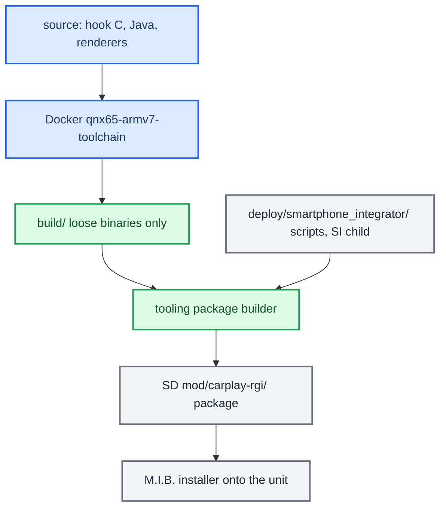

# Build and Deploy

*Map of content for turning source into shipped binaries, packaging them with the tooling repository, and getting them onto the head unit without bricking anything.*

---

## 📋 What this section covers

The build scripts do one job: compile source into loose binaries under `build/`. In this fork, packages come from the separate [mib2q-carplay-enhanced-tooling](https://github.com/waterfalldev/mib2q-carplay-enhanced-tooling) repository: it builds a committed revision against one firmware's stock files, runs the checks, and writes an SD overlay whose M.I.B. installer installs, verifies and rolls back. Upstream's `scripts/prepare_install.sh` and M.I.B. bundles are not carried here; a developer can still push single files over SSH by hand.

The separate [wireless stock210 review builder](../wireless-carplay/README.md#build-and-reproduce) assembles an offline review archive, not a shipping installer; its source remains under `wireless/`.

This page is the entry point for the domain. Start with [Build System](BUILD_SYSTEM.md) for how the Docker QNX toolchain produces the `.so` / renderers / jar, then [Deploy and Release](DEPLOY_AND_RELEASE.md) for what a package installs, what upstream's installer did beyond it and the hand-deploy traps, and [RE Artifacts](RE_ARTIFACTS.md) for where the reverse-engineering assets live. For the hub note and the trap list see [Home](../README.md) and [Landmines](../LANDMINES.md).

## 📊 Source to unit at a glance

## 🔗 The notes

| Note | What it covers |
|---|---|
| [Build System](BUILD_SYSTEM.md) | The Docker `qnx65-armv7-toolchain` (`:latest` = GCC 8.5); `build_hook.sh` and the shared compile+verify core; the ABI-safety asserts (emutls, export allowlist, `.init_array`, no libstdc++, QSA/HID export counts); Java, renderers, host tests, and the single-source APAC flags. |
| [Deploy and Release](DEPLOY_AND_RELEASE.md) | Builds emit binaries only; the tooling package's source→on-unit map; what upstream's installer did that the package does not (audio driver, firewall ports, phone-data IDs, replug fence); install, rollback and the route-guidance IDs; manual SSH push and its traps; never reboot the unit / jar deploy = full reboot. |
| [RE Artifacts](RE_ARTIFACTS.md) | Where the reverse-engineering assets now live: `assets/soundamp` (SHARC/amp RE) and `assets/vc-fonts` (VC font extraction) — what each is and its provenance. |
| [Scene Backend Deploy](SCENE_BACKEND_DEPLOY.md) | The scene upmix renderer package (2026-10-09): what `install_scene_unprotected.zip` carries, the commented-out `AUDIO_SCENE` enable block in `carplay_startup.sh`, how to read the hook log on the unit, how to roll back. |
| [Production Audits](PRODUCTION_AUDITS.md) | Ten release-safety and readiness reviews (Aug–Sep 2026): findings, fixes, status in today's code. |

## 💡 The one thing to remember

Deploying files is fine; **restarting the unit is not** — the user is usually in the car, and a jar redeploy takes the whole system down for ~50 s. Copy, report what is staged, and stop. See [Deploy and Release](DEPLOY_AND_RELEASE.md) and [Landmines](../LANDMINES.md).

Provenance lives in `docs/build-and-deploy/DEPLOY_AND_RELEASE.md`, the `scripts/build_*.sh` set, and the tooling repository's `packaging/` and `deploy/mib/`.
